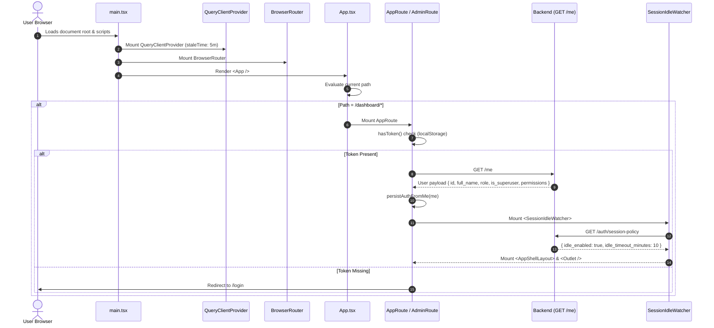
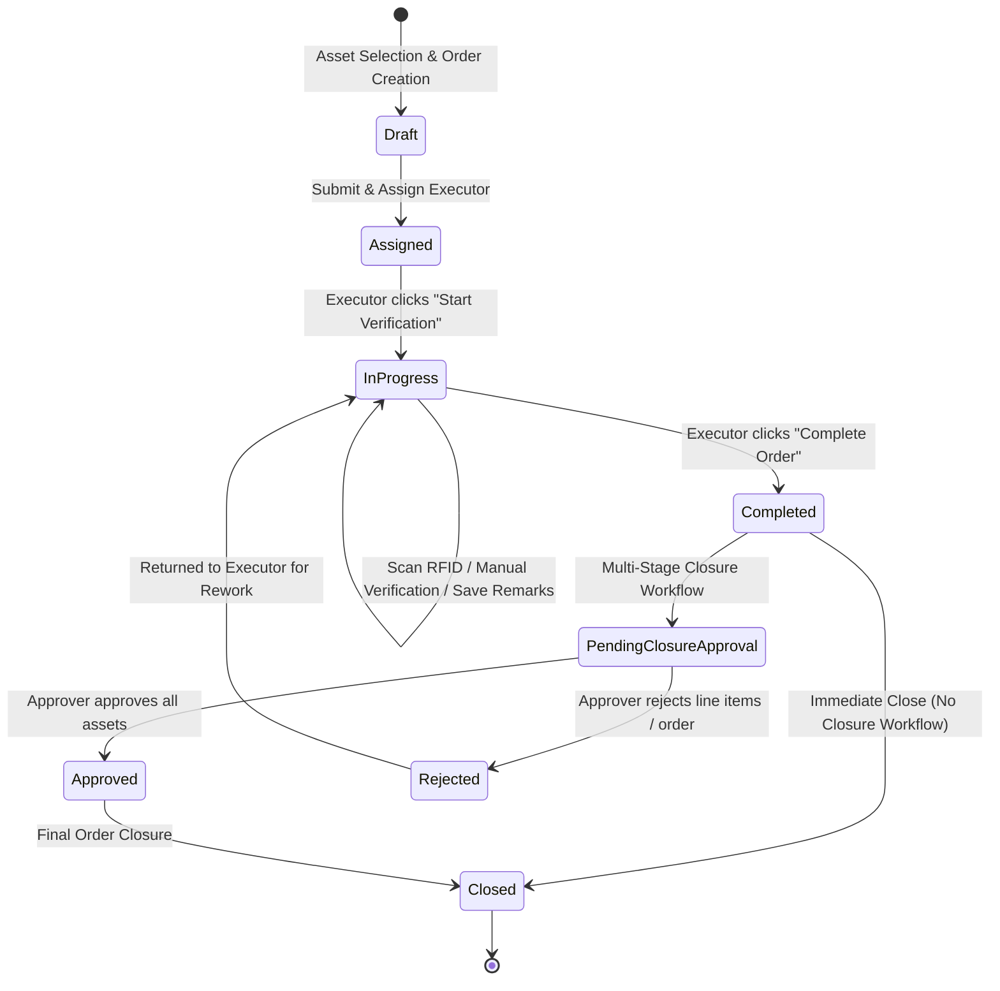
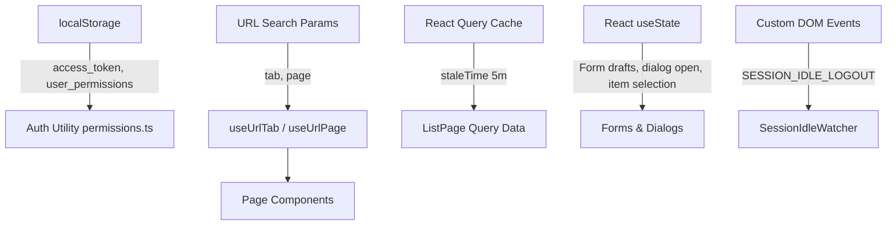

# Complete Frontend Codebase Audit
**Project Target:** Asset-Tagging-and-Tracking-Takeda-Web (`frontend/`)  
**Audit Date:** September 1, 2026  
**Status:** Complete Technical Audit (Read-Only Code Analysis)

---

## 1. Executive Summary

This document presents a deep, systematic technical audit of the complete frontend codebase for **Asset-Tagging-and-Tracking-Takeda-Web**. The frontend is built as a modern Single Page Application (SPA) leveraging React 19, TypeScript, Vite 8, Tailwind CSS v4, and TanStack React Query v5. It is designed to manage enterprise asset tracking, physical verification orders, RFID tag lifecycle, Capital Expenditure (CapEx) tracking, asset disposals, asset transfers, dynamic reporting, and role-based administration.

### Key Architectural Characteristics
- **Dual Layout Console Design**:
  - **Operational Workspace (`AppShellLayout`)**: Rooted at `/dashboard`, providing operational views for physical verification orders, asset masters, transfers, disposals, CapEx capitalization, my tasks, and custom reports.
  - **Administration Console (`AdminLayout`)**: Rooted at `/admin`, dedicated to superusers managing RBAC roles, permissions, system settings, master data lookup tables, user accounts, org units (plants/departments), email templates, and workflow assignment matrices.
- **State Management Taxonomy**:
  - **Server State**: Managed via TanStack React Query (`useQuery`, `QueryClient`).
  - **URL State**: Managed via custom hooks (`useUrlTab`, `useUrlPage`) syncing tab and pagination state to browser query parameters.
  - **Local Component State**: Managed via standard React hooks (`useState`, `useRef`, `useCallback`) for form inputs, dialog toggles, and detail view snapshots.
  - **Persistent Session State**: Managed via `localStorage` for JWT tokens (`access_token`, `refresh_token`), user permissions (`user_permissions`), user ID, and superuser flags.
- **Session Policy & Inactivity Engine**: Implements cross-tab idle synchronization using `BroadcastChannel` and `StorageEvent` triggers, bound to server-controlled session policies retrieved from `/auth/session-policy`.

---

## 2. Project Structure

### Directory Map (`frontend/`)

```text
frontend/
├── .env.example
├── Dockerfile
├── components.json              # Shadcn UI configuration
├── eslint.config.js             # ESLint flat configuration (ESLint 9)
├── index.html                   # HTML entry point template
├── nginx.conf / nginx-map.conf  # Production Nginx reverse proxy configs
├── package.json / package-lock.json
├── tsconfig.json / tsconfig.app.json / tsconfig.node.json
├── vite.config.ts               # Vite bundler & dev proxy setup
├── public/                      # Static assets (logos, favicon)
└── src/
    ├── App.css                  # Custom styling & font utilities
    ├── App.tsx                  # Master router, auth guard & layout orchestrator
    ├── index.css                # Tailwind v4 directives, design tokens, OKLCH colors
    ├── main.tsx                 # React DOM mount point & global providers
    ├── assets/                  # Visual assets & SVGs
    ├── components/              # Modular UI components
    │   ├── admin/               # RBAC guards & admin-specific widgets
    │   │   ├── access-denied.tsx
    │   │   ├── multi-check-list.tsx
    │   │   └── require-permission.tsx
    │   ├── assets/              # Asset-specific dialogs, panels, import grids
    │   │   ├── asset-actions-menu.tsx
    │   │   ├── asset-audit-log.tsx
    │   │   ├── asset-detail-section-panel.tsx
    │   │   ├── asset-export-dialog.tsx
    │   │   ├── asset-image.tsx
    │   │   ├── asset-import-grid.tsx
    │   │   ├── asset-import-progress.tsx
    │   │   ├── asset-master-detail-dialog.tsx
    │   │   ├── asset-master-panel.tsx
    │   │   ├── asset-master-readonly-view.tsx
    │   │   ├── asset-rfid-dialog.tsx
    │   │   ├── capex-form-search-select.tsx
    │   │   ├── required-field-mark.tsx
    │   │   └── tag-color-select.tsx
    │   ├── audit/               # Generic audit trail table
    │   │   └── audit-trail-table.tsx
    │   ├── auth/                # Login branding and SSO components
    │   │   ├── auth-brand-mark.tsx
    │   │   ├── auth-field-styles.ts
    │   │   ├── auth-form-shell.tsx
    │   │   ├── auth-shell-mode.tsx
    │   │   └── sso-sign-in-button.tsx
    │   ├── dashboard/           # Dashboard gauges, KPI cards, charts
    │   │   ├── asset-dashboard.tsx
    │   │   ├── dashboard-charts.tsx
    │   │   ├── dashboard-gauge-math.check.ts
    │   │   ├── dashboard-gauge-math.ts
    │   │   ├── dashboard-insight-card.tsx
    │   │   ├── dashboard-kpi.tsx
    │   │   ├── dashboard-loading.tsx
    │   │   ├── dashboard-theme.ts
    │   │   ├── financial-year-dashboard.tsx
    │   │   ├── it-dashboard.tsx
    │   │   ├── orders-dashboard.tsx
    │   │   ├── task-dashboard.tsx
    │   │   ├── user-dashboard.tsx
    │   │   └── workflow-orders-dashboard.tsx
    │   ├── layout/              # App Shell, Admin Layout, page headers, tables
    │   │   ├── admin-layout.tsx
    │   │   ├── admin-page.tsx
    │   │   ├── admin-ui.tsx
    │   │   ├── app-auth-marketing-layout.tsx
    │   │   ├── app-brand-mark.tsx
    │   │   ├── app-layout.tsx
    │   │   ├── app-shell-layout.tsx
    │   │   ├── list-page-ui.tsx
    │   │   ├── mobile-nav-drawer.tsx
    │   │   └── sortable-column-header.tsx
    │   ├── masters/             # Master data CRUD panels & custodian managers
    │   │   ├── cost-center-custodians-panel.tsx
    │   │   ├── hierarchical-master-panel.tsx
    │   │   └── master-crud-panel.tsx
    │   ├── orders/              # Order lifecycle stepper & audit logs
    │   │   ├── order-audit-log.tsx
    │   │   └── order-lifecycle-stepper.tsx
    │   ├── reports/             # Report generation dialogs & tiles
    │   │   ├── report-generate-dialog.tsx
    │   │   └── report-tile.tsx
    │   ├── ui/                  # Shadcn primitive UI components
    │   │   ├── alert.tsx, avatar.tsx, badge.tsx, button.tsx, card.tsx, checkbox.tsx,
    │   │   ├── confirm-dialog.tsx, dialog.tsx, dropdown-menu.tsx, input.tsx, label.tsx,
    │   │   ├── password-input.tsx, scroll-area.tsx, select.tsx, separator.tsx,
    │   │   └── skeleton.tsx, sonner.tsx, switch.tsx, table.tsx, tabs.tsx
    │   ├── users/               # User audit logs & cost center pickers
    │   │   ├── user-audit-log.tsx
    │   │   └── user-cost-centers.tsx
    │   ├── app-toaster.tsx      # Sonner toast provider setup
    │   ├── approval-workflow-timeline.tsx # Multi-stage approval timeline
    │   ├── profile-dialog.tsx   # User profile edit dialog
    │   ├── session-idle-navbar-badge.tsx # Active idle timer indicator
    │   └── session-idle-watcher.tsx      # Global idle event wrapper
    ├── context/
    │   └── session-idle-context.tsx      # Session inactivity Context provider
    ├── lib/                     # Utilities, API client, types & domain helpers
    │   ├── api.ts               # Custom fetch client, JWT handling, error formatters
    │   ├── asset-actions.ts     # Selection actions & bulk eligibility logic
    │   ├── asset-lifecycle.ts   # Asset status transition helper state machines
    │   ├── asset-master-fields.ts# Dynamic Asset field metadata configurations
    │   ├── asset-physical-order-display.tsx
    │   ├── assets-types.ts      # TypeScript interfaces for Asset domain
    │   ├── auth-routes.ts       # Auth route helpers
    │   ├── brand.ts             # Brand constants
    │   ├── capex-types.ts       # CapEx domain interfaces
    │   ├── dashboard-permissions.ts # Dashboard RBAC permission lists
    │   ├── dashboard-utils.ts   # Chart & gauge math helpers
    │   ├── dates.ts             # Date formatting utilities (date-fns / Intl)
    │   ├── disposal-types.ts    # Disposal order types
    │   ├── login-identifier.ts  # Login input sanitization helpers
    │   ├── masters-types.ts     # Master data types
    │   ├── navbar-user.ts       # User header profile type
    │   ├── orders-types.ts      # Physical order domain types
    │   ├── permissions.ts       # RBAC check utilities (`hasPermission`)
    │   ├── phone.ts             # Phone validation helpers
    │   ├── query-client.ts      # TanStack QueryClient instance & root keys
    │   ├── reports-types.ts     # Report types
    │   ├── session-idle-events.ts # Idle custom DOM events
    │   ├── transfer-types.ts    # Transfer order types
    │   ├── use-asset-field-config.ts # Asset field visibility hooks
    │   ├── use-asset-masters.ts # Custom hook for master dropdown data
    │   ├── use-url-tab.ts       # Sync tab & page state with URL search params
    │   └── utils.ts             # Tailwind `cn()` helper
    ├── pages/                   # Application Page Components
    │   ├── admin-overview.tsx   # Admin dashboard summary page
    │   ├── app-login.tsx        # Modern user login view
    │   ├── assets.tsx           # Route re-export wrapper
    │   ├── auth-settings.tsx    # Auth configuration page
    │   ├── dashboard.tsx        # Main Operational Dashboard
    │   ├── departments.tsx      # Department management
    │   ├── email-templates.tsx  # Email template editor
    │   ├── forgot-password.tsx  # Password recovery request page
    │   ├── login.tsx            # Legacy/Admin login view
    │   ├── mfa-setup.tsx        # Multi-factor authentication setup
    │   ├── my-task-detail.tsx   # Task item approval detail view
    │   ├── my-tasks.tsx         # My Pending Tasks list view
    │   ├── permissions.tsx      # Permission code management
    │   ├── plants.tsx           # Plant / Org unit management
    │   ├── reset-password.tsx   # Password reset execution page
    │   ├── roles.tsx            # RBAC Role management
    │   ├── settings.tsx         # System settings page
    │   ├── sso-callback.tsx     # OAuth/SSO callback handler
    │   ├── user-create.tsx      # User creation form page
    │   ├── user-edit.tsx        # User edit form page
    │   ├── user-view.tsx        # User profile view page
    │   ├── users.tsx            # Users list page
    │   ├── workflow-assignment.tsx # Approval workflow assignment page
    │   ├── assets/              # Asset List, Create, Detail, Import pages
    │   │   ├── asset-create.tsx
    │   │   ├── asset-detail.tsx
    │   │   ├── asset-import.tsx
    │   │   └── assets-list.tsx
    │   ├── capex/               # CapEx List, Create, Detail, Print pages
    │   │   ├── capex-assignee-picker-dialog.tsx
    │   │   ├── capex-audit-log.tsx
    │   │   ├── capex-cost-center-select.tsx
    │   │   ├── capex-create.tsx
    │   │   ├── capex-decision-dialog.tsx
    │   │   ├── capex-detail.tsx
    │   │   ├── capex-list.tsx
    │   │   ├── capex-print-form.tsx
    │   │   └── capex-process-flow.tsx
    │   ├── disposals/           # Disposal List, Create, Detail pages
    │   │   ├── disposal-audit-log.tsx
    │   │   ├── disposal-create.tsx
    │   │   ├── disposal-detail.tsx
    │   │   └── disposals-list.tsx
    │   ├── masters/             # Master Data management page
    │   │   └── masters-page.tsx
    │   ├── orders/              # Physical Order List, Detail, Create dialog
    │   │   ├── create-order-dialog.tsx
    │   │   ├── order-detail.tsx
    │   │   └── orders-list.tsx
    │   ├── reports/             # Custom Reports generation page
    │   │   └── reports-page.tsx
    │   └── transfers/           # Transfer Order List, Create, Detail pages
    │       ├── transfer-audit-log.tsx
    │       ├── transfer-create.tsx
    │       ├── transfer-detail.tsx
    │       └── transfers-list.tsx
    └── styles/
        └── app-design.css       # Design tokens, table classes, custom scrollbars
```

---

## 3. Package / Dependency Analysis

### Dependencies Inventory (`package.json`)

| Package Name | Version | Primary Purpose | Scope & Usage Locations |
| :--- | :--- | :--- | :--- |
| `react` | `^19.2.5` | Core UI Library | Global runtime framework |
| `react-dom` | `^19.2.5` | React DOM Renderer | Entry point (`main.tsx`) |
| `react-router-dom` | `^7.14.1` | SPA Routing | Routing definition (`App.tsx`, `main.tsx`) |
| `@tanstack/react-query` | `^5.102.8` | Server State Management | Cache management (`query-client.ts`, `orders-list.tsx`, `assets-list.tsx`) |
| `@tanstack/react-virtual` | `^3.13.25` | Virtualized Table Rendering | Asset Bulk Import (`asset-import-grid.tsx`) |
| `react-hook-form` | `^7.72.1` | Form State Management | Login (`login.tsx`), User forms (`user-create.tsx`, `user-edit.tsx`) |
| `zod` | `^4.3.6` | Schema Validation | Form schemas (`login.tsx`, `user-create.tsx`, `user-edit.tsx`, `phone.ts`) |
| `@hookform/resolvers` | `^5.2.2` | RHF + Zod Integration | Form resolvers (`login.tsx`, `user-create.tsx`, `user-edit.tsx`) |
| `lucide-react` | `^1.8.0` | UI Vector Icons | Application icons throughout components |
| `recharts` | `^3.8.1` | Analytics Data Visualization | Dashboard charts ([`dashboard-charts.tsx`](file:///d:/TZ/Asset-Tagging-and-Tracking-Takeda-Web/frontend/src/components/dashboard/dashboard-charts.tsx)) |
| `sonner` | `^2.0.7` | Toast Notifications | App Toaster setup (`app-toaster.tsx`, `sonner.tsx`) and global API notifications |
| `next-themes` | `^0.4.6` | Theme Context Provider | Theme resolution in Toast Provider ([`sonner.tsx`](file:///d:/TZ/Asset-Tagging-and-Tracking-Takeda-Web/frontend/src/components/ui/sonner.tsx#L3)) |
| `class-variance-authority` | `^0.7.1` | Component Styling Variants | Shadcn component variants (`button.tsx`, `badge.tsx`) |
| `clsx` | `^2.1.1` | Class String Utility | Class composition in [`utils.ts`](file:///d:/TZ/Asset-Tagging-and-Tracking-Takeda-Web/frontend/src/lib/utils.ts) |
| `tailwind-merge` | `^3.5.0` | Tailwind Class Merging | `cn()` helper function |
| `@tailwindcss/vite` | `^4.2.2` | Tailwind CSS v4 Vite Plugin | Build configuration (`vite.config.ts`) |
| `tw-animate-css` | `^1.4.0` | CSS Animations Plugin | Animation imports in `index.css` |
| `@fontsource-variable/geist`| `^5.2.8` | Geist Font Package | Typography stylesheet in `index.css` |
| `shadcn` | `^4.3.0` | Shadcn CLI Package | Meta dependency in runtime `dependencies` |
| `radix-ui` | `^1.4.3` | UI Primitives Bundle | Meta package in `dependencies` |

### Dependency Findings & Anomalies
1. **Mislocated CLI Dependency**: `shadcn` (`^4.3.0`) is listed under `dependencies` in `package.json`. As a code-generation CLI tool, it should reside under `devDependencies`.
2. **Potentially Redundant Primitive Meta-Package**: `radix-ui` (`^1.4.3`) is listed as a monolithic dependency, whereas components directly import specific radix primitives or implement styled JSX components.

---

## 4. Application Startup

### Startup Execution Pipeline



### Automatic Startup HTTP Requests
1. `GET /me`: Executed automatically on mounting [`AppRoute`](file:///d:/TZ/Asset-Tagging-and-Tracking-Takeda-Web/frontend/src/App.tsx#L470) or [`AdminRoute`](file:///d:/TZ/Asset-Tagging-and-Tracking-Takeda-Web/frontend/src/App.tsx#L557). Refreshes user details, active RBAC permissions, and superuser flags into `localStorage`.
2. `GET /auth/session-policy`: Executed automatically by [`SessionIdleProvider`](file:///d:/TZ/Asset-Tagging-and-Tracking-Takeda-Web/frontend/src/context/session-idle-context.tsx#L97) upon mounting protected layout wrappers. Fetches server-defined idle timeout settings.

---

## 5. Routing Analysis

Routes are defined declaratively in [`App.tsx`](file:///d:/TZ/Asset-Tagging-and-Tracking-Takeda-Web/frontend/src/App.tsx#L61) using React Router v7.

### Complete Route Inventory Table

| Route | Component | Auth Required | Permission Code | Purpose | Primary Endpoints |
| :--- | :--- | :--- | :--- | :--- | :--- |
| `/` | `Navigate` | No | None | Redirects to `/login` | None |
| `/login` | `AppLoginPage` | No | None | Operational User Login View | `POST /login` |
| `/admin/login` | `LoginPage` | No | None | Admin Console Login View | `POST /login` |
| `/forgot-password` | `ForgotPasswordPage` | No | None | Password Recovery Request | `POST /forgot-password` |
| `/reset-password` | `ResetPasswordPage` | No | None | Password Reset Execution | `POST /reset-password` |
| `/mfa/setup` | `MfaSetupPage` | No | None | Multi-Factor Auth Setup | `POST /auth/mfa/setup` |
| `/sso/callback` | `SsoCallbackPage` | No | None | Single Sign-On OAuth Callback | `GET /auth/sso/callback` |
| `/dashboard` | `DashboardPage` | Yes | `DASHBOARD_ANY_OF` | Main Operational Dashboard | `GET /dashboard` |
| `/dashboard/reports` | `ReportsPage` | Yes | `report.view` | Custom Report Generator | `GET /reports` |
| `/dashboard/assets` | `AssetsListPage` | Yes | `asset.view` | Asset Master Grid | `GET /admin/assets` |
| `/dashboard/assets/new` | `AssetCreatePage` | Yes | `asset.create` | Manual Asset Creation | `POST /admin/assets` |
| `/dashboard/assets/import`| `AssetImportPage` | Yes | `asset.import` / `asset.manage` | Virtualized Bulk Asset Import | `POST /admin/assets/import` |
| `/dashboard/assets/:id` | `AssetDetailPage` | Yes | `asset.view` | Asset Detail View & Edit | `GET /admin/assets/:id` |
| `/dashboard/masters` | `MastersPage` | Yes | `masters.view`+ | System Lookups / Masters CRUD | `GET /admin/masters` |
| `/dashboard/orders` | `OrdersListPage` | Yes | `order.view` | Physical Verification Orders List | `GET /admin/physical-orders` |
| `/dashboard/orders/:id` | `OrderDetailPage` | Yes | `order.view` | Physical Verification Execution | `GET /admin/physical-orders/:id` |
| `/dashboard/transfer-orders`| `TransferOrdersListPage`| Yes | `transfer.view` | Asset Transfer Orders List | `GET /admin/asset-transfers` |
| `/dashboard/transfer-orders/new`| `TransferOrderCreatePage`| Yes | `transfer.create` | Asset Transfer Order Creation | `POST /admin/asset-transfers` |
| `/dashboard/transfer-orders/:id`| `TransferOrderDetailPage`| Yes | `transfer.view` | Asset Transfer Execution | `GET /admin/asset-transfers/:id` |
| `/dashboard/disposal-orders`| `DisposalOrdersListPage`| Yes | `disposal.view` | Asset Disposal Orders List | `GET /admin/asset-disposals` |
| `/dashboard/disposal-orders/new`| `DisposalOrderCreatePage`| Yes | `disposal.create` | Asset Disposal Order Creation | `POST /admin/asset-disposals` |
| `/dashboard/disposal-orders/:id`| `DisposalOrderDetailPage`| Yes | `disposal.view` | Asset Disposal Execution | `GET /admin/asset-disposals/:id` |
| `/dashboard/capitalization`| `CapexListPage` | Yes | `capitalization.view` | CapEx Projects List | `GET /admin/capex` |
| `/dashboard/capitalization/new`| `CapexCreatePage` | Yes | `capitalization.create` | CapEx Entry Creation | `POST /admin/capex` |
| `/dashboard/capitalization/:id`| `CapexDetailPage` | Yes | `capitalization.view` | CapEx Workflow Execution | `GET /admin/capex/:id` |
| `/dashboard/users` | `UsersPage` | Yes | `users.view` | Workspace Users List | `GET /admin/users` |
| `/dashboard/users/new` | `UserCreatePage` | Yes | `users.create` | Workspace User Creation | `POST /admin/users` |
| `/dashboard/users/:id` | `UserViewPage` | Yes | `users.view` | Workspace User Profile View | `GET /admin/users/:id` |
| `/dashboard/users/:id/edit`| `UserEditPage` | Yes | `users.update` | Workspace User Edit | `PUT /admin/users/:id` |
| `/dashboard/tasks` | `MyTasksPage` | Yes | `TASK_ACCESS_PERMISSIONS`| Pending Workflow Tasks | `GET /tasks` |
| `/dashboard/tasks/:taskId`| `MyTaskDetailPage` | Yes | `TASK_ACCESS_PERMISSIONS`| Workflow Action Execution | `GET /tasks/:taskId` |
| `/dashboard/plants` | `PlantsPage` | Yes | `org_units.view`+ | Plant Org Units Management | `GET /admin/org-units` |
| `/dashboard/departments`| `DepartmentsPage` | Yes | `org_units.view`+ | Department Management | `GET /admin/departments` |
| `/dashboard/roles` | `RolesPage` | Yes | `roles.view`+ | RBAC Role Configuration | `GET /admin/roles` |
| `/dashboard/permissions` | `PermissionsPage` | Yes | `permissions.view`+ | Permission Codes Registry | `GET /admin/permissions` |
| `/dashboard/system-settings`| `SettingsPage` | Yes | `SETTINGS_ACCESS_PERMISSIONS`| System Settings Configuration | `GET /admin/settings` |
| `/admin` | `AdminOverviewPage` | Yes (Superuser)| `is_superuser === true` | Admin Console Overview | `GET /admin/overview` |
| `/admin/workflow-assignment`| `WorkflowAssignmentPage`| Yes (Superuser)| `approval.manage` | Workflow Approvers Matrix | `GET /admin/workflows` |
| `/admin/email-templates`| `EmailTemplatesPage`| Yes (Superuser)| `email_templates.view`+ | Email Template Management | `GET /admin/email-templates`|
| `*` | `Navigate` | No | None | Catch-all redirect to `/login` | None |

---

## 6. Authentication Analysis

### Authentication Token Handling
Authentication is token-based using Bearer JWT pairs stored in `localStorage`:
- `access_token`: Short-lived Bearer token passed in the `Authorization` header of API requests.
- `refresh_token`: Token used to request new access tokens via `POST /refresh`.
- `user_permissions`: JSON serialized string array containing permissions snapshot (e.g. `["order.view", "asset.create"]`).
- `me_is_superuser`: String `"1"` or `"0"`.
- `me_user_id`: Numeric user identifier.

### Token Expiration & Proactive Refresh Logic ([`api.ts`](file:///d:/TZ/Asset-Tagging-and-Tracking-Takeda-Web/frontend/src/lib/api.ts#L52-L109))
1. **Expiration Calculation**: `accessTokenExpiresAtMs(token)` decodes the base64 payload of the JWT access token and reads the `exp` claim.
2. **Buffer Window**: If `exp - Date.now() < 2 minutes` (`REFRESH_BUFFER_MS`), `ensureFreshAccessToken()` triggers token refresh.
3. **Single Flight Lock**: `refreshInFlight` holds the pending refresh promise, guaranteeing that multiple parallel API requests do not trigger concurrent token refresh requests.
4. **401 Interceptor**: If an API call fails with HTTP 401 and `allowRefresh` is enabled, `fetchWithAuth` attempts a refresh once. If the refresh succeeds, the original request is retried. If the refresh fails or returns a `session_idle` detail, `maybeDispatchAuthLogout()` fires `SESSION_IDLE_LOGOUT_EVENT`.

---

## 7. API Architecture

### Configuration & Base URL ([`api.ts`](file:///d:/TZ/Asset-Tagging-and-Tracking-Takeda-Web/frontend/src/lib/api.ts#L1))
`API_BASE_URL` is populated from `import.meta.env.VITE_API_URL`. In development mode, it defaults to an empty string (`""`), delegating request routing to Vite's server proxy configured in [`vite.config.ts`](file:///d:/TZ/Asset-Tagging-and-Tracking-Takeda-Web/frontend/src/vite.config.ts#L12) target `http://localhost:8000`.

### Proxy Endpoint Mapping ([`vite.config.ts`](file:///d:/TZ/Asset-Tagging-and-Tracking-Takeda-Web/frontend/src/vite.config.ts#L12-L95))
Vite proxies the following API prefixes to the backend server:
`/login`, `/forgot-password`, `/reset-password`, `/refresh`, `/me`, `/approvals`, `/audit`, `/dashboard`, `/tasks`, `/reports`, `/auth`, `/admin`.
*Note*: Endpoints for `/orders`, `/assets`, `/users`, `/masters` are prefixed with `/admin/` in the backend API router (e.g., `/admin/physical-orders`, `/admin/assets`).

### API Method Helpers Inventory

| Function Signature | HTTP Method | Input Payload | Output / Purpose |
| :--- | :--- | :--- | :--- |
| `getJson<T>(path, init?)` | `GET` | URL query params | Parses JSON response |
| `postJson<T>(path, body, init?)` | `POST` | JSON Object | Resource creation & actions |
| `patchJson<T>(path, body, init?)` | `PATCH` | JSON Object | Partial updates (e.g. order remarks) |
| `putJson<T>(path, body, init?)` | `PUT` | JSON Object | Full updates (e.g. master data) |
| `deleteJson(path, init?)` | `DELETE` | N/A | Resource deletion |
| `postBlob(path, body)` | `POST` | JSON Object | Blob data retrieval |
| `getBlob(path)` | `GET` | N/A | Blob data retrieval |
| `putFormData<T>(path, body)` | `PUT` | `FormData` | File uploads |
| `downloadFile(path, fallback)` | `GET` | N/A | File download execution |

---

## 8. TanStack React Query Analysis

### Query Client Defaults ([`query-client.ts`](file:///d:/TZ/Asset-Tagging-and-Tracking-Takeda-Web/frontend/src/lib/query-client.ts))
```typescript
export const LIST_STALE_MS = 5 * 60 * 1000 // 5 minutes
export const LIST_GC_MS = 30 * 60 * 1000   // 30 minutes

export const queryClient = new QueryClient({
  defaultOptions: {
    queries: {
      staleTime: LIST_STALE_MS,
      gcTime: LIST_GC_MS,
      refetchOnWindowFocus: false,
    },
  },
})
```

### Query Keys Inventory

| Query Name | Query Key Structure | Component Owner | Invalidation Helper |
| :--- | :--- | :--- | :--- |
| Orders List | `["orders", "list", { tab, page, search, columnFilters, sortBy, sortDir }]` | [`OrdersListPage`](file:///d:/TZ/Asset-Tagging-and-Tracking-Takeda-Web/frontend/src/pages/orders/orders-list.tsx#L145) | `invalidateOrderLists()` |
| Assets List | `["assets", "list", { page, search, filters, listTab, fySubTab, ... }]` | [`AssetsListPage`](file:///d:/TZ/Asset-Tagging-and-Tracking-Takeda-Web/frontend/src/pages/assets/assets-list.tsx#L629) | `invalidateAssetLists()` |

---

## 9. Orders Module — Deep Analysis

### Complete Physical Order Flow State Diagram



### Deep Audit of Asset Count Inconsistency & Vanishing Asset Problem

> **Reported Issue**: The number of assets in physical order lists fluctuates, and assets sometimes appear to vanish.

#### Technical Diagnosis & Root Causes
1. **State Ownership Fragmentation**:
   - `OrdersListPage` uses TanStack React Query with a **5-minute `staleTime`** (`LIST_STALE_MS`).
   - `OrderDetailPage` does **NOT** use React Query; it uses local React state (`useState`) and fetches data manually via `getJson()`.
   - When an order item is scanned, approved, or modified in `OrderDetailPage`, local component state is updated via `setOrder(res)`. Although `invalidateOrderLists()` is called, if the user returns to `/dashboard/orders`, React Query will return the cached list snapshot if the query key matches and the cache window has not expired.
2. **Debounced Filter Query Key Mismatch**:
   - In `OrdersListPage`, column filters use a 300ms debounce before applying `setColumnFilters`. If a user navigates between tabs rapidly, queries execute with outdated filter parameters, returning different row subsets.
3. **Current FY Verification Reset Logic**:
   - When creating a Physical Verification Order containing assets previously verified in the current Financial Year, `reset_verification_asset_ids` triggers a backend state reset. The backend updates `pending_physical_count` vs `physically_verified_count`, causing list summary pill counts to change.
4. **Local Pagination Slicing vs Total Assets**:
   - In `OrderDetailPage`, asset items are stored in a full array (`order.items`), but sliced locally into pages of 25 (`ORDER_ASSETS_PAGE_SIZE = 25`). Applying column filters (e.g. status = `pending`) hides non-matching items from the table pagination, which can be interpreted as missing assets if total counts are not clearly distinguished from filtered page counts.

---

## 10. Asset Module — Deep Analysis

### Features & Capabilities
- **Master Asset Data Grid**: [`assets-list.tsx`](file:///d:/TZ/Asset-Tagging-and-Tracking-Takeda-Web/frontend/src/pages/assets/assets-list.tsx) provides searching, multi-column sorting, column preference persistence (`PUT /admin/assets/list-columns`), and filter tabs (`All`, `Pending Approval`, `Approved`, `Financial Year`).
- **Bulk Selection & Action Engine**: [`asset-actions.ts`](file:///d:/TZ/Asset-Tagging-and-Tracking-Takeda-Web/frontend/src/lib/asset-actions.ts) evaluates selected assets to compute bulk action eligibility (Attach RFID, Create Verification Order, Initiate Disposal, Initiate Transfer).
- **Virtualized Excel/CSV Import**: [`asset-import-grid.tsx`](file:///d:/TZ/Asset-Tagging-and-Tracking-Takeda-Web/frontend/src/components/assets/asset-import-grid.tsx) uses `@tanstack/react-virtual` to render large import datasets efficiently without DOM degradation.

---

## 11. RFID / Tagging Functionality

### Data & Execution Flow
1. **Manual / Wedge RFID Attachment**:
   - Managed via [`AssetRfidDialog`](file:///d:/TZ/Asset-Tagging-and-Tracking-Takeda-Web/frontend/src/components/assets/asset-rfid-dialog.tsx). Users manually enter or scan RFID tags using a USB/Keyboard-wedge scanner that types tag strings into the focused input field.
2. **Physical Verification Scanning**:
   - In [`order-detail.tsx`](file:///d:/TZ/Asset-Tagging-and-Tracking-Takeda-Web/frontend/src/pages/orders/order-detail.tsx#L1115), selecting an asset opens the scan panel. Entering a tag or pressing Enter triggers `postJson('/admin/physical-orders/:id/scan', { scan_value, item_id })`.
3. **Hardware / Device Integration Assessment**:
   - The frontend currently relies on keyboard wedge emulation. No direct WebBluetooth, WebUSB, WebSerial, or WebSocket RFID reader integrations exist in the frontend code.

---

## 12. Modals / Dialogs / Popups Inventory

| Dialog Component | Trigger Source | Title | Purpose | Size Class |
| :--- | :--- | :--- | :--- | :--- |
| `CreatePhysicalOrderDialog` | Asset List Toolbar | Create Physical Verification Order | Select assignee & create order from selected assets | `sm:max-w-md` |
| `AssetRfidDialog` | Asset Row / Action | Attach RFID / Update RFID | Attach or update RFID tag code | `sm:max-w-md` |
| `CapexAssigneePickerDialog` | CapEx / Order Detail | Select Approver / Next Assignee | Select workflow approver for multi-stage steps | `sm:max-w-md` |
| `ReportGenerateDialog` | Reports Page | Generate Report | Configure parameters & download file | `sm:max-w-lg` |
| `AssetExportDialog` | Asset List Toolbar | Export Assets | Select columns & format for export | `sm:max-w-lg` |
| `ProfileDialog` | Navbar Profile Menu | User Profile | View & edit current user info | `sm:max-w-md` |
| `ConfirmDialog` | `useConfirmDialog` Hook | Dynamic (e.g. Delete Draft) | Reusable confirmation modal | `sm:max-w-md` |

---

## 13. UI / UX Consistency

- **Design System Tokens**: Configured in [`app-design.css`](file:///d:/TZ/Asset-Tagging-and-Tracking-Takeda-Web/frontend/src/styles/app-design.css) using OKLCH color spaces, Takeda Brand Red (`#E1242A`), Geist Variable typography, and standardized control metrics (`--app-card-padding: 1.25rem`, `--app-table-row-height: 3.25rem`).
- **Status Pills**: `AdminPillBadge` standardized across all list views with unified tones (`success`, `warning`, `danger`, `neutral`).

---

## 14. State Management Taxonomy



---

## 15. Forms & Validation

Form management follows two primary implementations:
1. **React Hook Form + Zod**: Used in [`login.tsx`](file:///d:/TZ/Asset-Tagging-and-Tracking-Takeda-Web/frontend/src/pages/login.tsx#L77), [`user-create.tsx`](file:///d:/TZ/Asset-Tagging-and-Tracking-Takeda-Web/frontend/src/pages/user-create.tsx#L82), and [`user-edit.tsx`](file:///d:/TZ/Asset-Tagging-and-Tracking-Takeda-Web/frontend/src/pages/user-edit.tsx#L100).
2. **Controlled React State**: Used in modal dialogs ([`create-order-dialog.tsx`](file:///d:/TZ/Asset-Tagging-and-Tracking-Takeda-Web/frontend/src/pages/orders/create-order-dialog.tsx)) with custom error formatters (`formatFastapiValidationDetail`).

---

## 16. Tables & Lists Architecture

Tables use shared design primitives defined in [`list-page-ui.tsx`](file:///d:/TZ/Asset-Tagging-and-Tracking-Takeda-Web/frontend/src/components/layout/list-page-ui.tsx) and [`admin-ui.tsx`](file:///d:/TZ/Asset-Tagging-and-Tracking-Takeda-Web/frontend/src/components/layout/admin-ui.tsx):
- `AdminDataTable`: Card container with overflow control and sticky headers (`app-table-head-sticky`).
- `AdminTablePagination`: Standardized pagination bar with items count, page navigation, and loading states.
- `SortableColumnHeader`: Header component handling column sort toggles (`asc` -> `desc` -> default).

---

## 17. Error Handling Architecture

### API Exception Propagation Pipeline
1. `fetchWithAuth()` executes HTTP request.
2. If non-OK response (`!res.ok`), `parseResponseBody()` parses error text.
3. FastAPI validation details (array of `{ loc, msg, type }`) are parsed into user-friendly field messages by `formatFastapiValidationDetail()`.
4. An `ApiError` object containing `status`, `message`, and raw `body` is thrown.
5. Page components catch `ApiError` and display toast alerts via `toast.error(e.message)`.
6. HTTP 401 dispatches `SESSION_IDLE_LOGOUT_EVENT`, triggering token cleanup and redirecting to login.

---

## 18. Loading, Empty, & Success States

- **Loading**: Tables show `AdminTableEmptyRow` with "Loading orders…" or centered `Loader2` spinners.
- **Empty States**: Customized via domain helpers like `orderTabEmptyMessage(tab)`.
- **Success States**: Actions trigger `toast.success()` and invalidate relevant query caches.

---

## 19. Performance Analysis

- **Virtualized Grids**: Large bulk asset imports use `@tanstack/react-virtual` to avoid rendering large numbers of un-virtualized DOM elements.
- **Debounced Input Queries**: Text search fields and column inputs use `300ms` debouncers to reduce API call frequency.

---

## 20. TypeScript Analysis

- **Strict Mode**: Enabled in `tsconfig.app.json` (`"strict": true`).
- **Interfaces**: Explicit interfaces exist for all domain entities (`PhysicalOrderDetail`, `AssetListResponse`, `CapExDetail`).
- **Unsafe Casts**: Limited use of `as unknown as TResponse` in generic API fetch wrappers.

---

## 21. Technical Debt Inventory

1. **Monolithic Page Files**:
   - `assets-list.tsx`: ~2,740 lines.
   - `order-detail.tsx`: ~1,747 lines.
   - `asset-detail.tsx`: ~1,100 lines.
2. **Duplicate Detail Fetching Patterns**: Detail pages use manual `useState` + `getJson` instead of React Query `useQuery`, requiring manual listener hooks for window focus/visibility.

---

## 22. Security Review

- **Token Storage**: JWT access and refresh tokens are stored in `localStorage`.
- **RBAC Route Guarding**: Protected routes are wrapped in `<RequirePermission>` guards and layout authorization checks.
- **Secrets Management**: No API keys or backend secrets are hardcoded in frontend source files.

---

## 23. Configuration & Environment

### Environment Variables
- `VITE_API_URL`: Backend API URL target.

---

## 24. Unused & Dead Code Inventory

| File Path | Description | Confidence |
| :--- | :--- | :--- |
| `src/pages/assets.tsx` | Re-export placeholder (`export default function Assets() { return null }`) | High |
| `src/components/dashboard/dashboard-gauge-math.check.ts` | Test check file leftover | Medium |

---

## 25. Prioritized Bug Inventory

| Bug ID | Severity | File Path | Root Cause | Suggested Fix Direction |
| :--- | :--- | :--- | :--- | :--- |
| **BUG-01** | **P1** | [`orders-list.tsx`](file:///d:/TZ/Asset-Tagging-and-Tracking-Takeda-Web/frontend/src/pages/orders/orders-list.tsx#L173) | 5-minute React Query `staleTime` causes stale asset counts in lists after detail updates. | Reduce list `staleTime` or ensure invalidateQueries forces immediate refetch on navigation. |
| **BUG-02** | **P2** | [`order-detail.tsx`](file:///d:/TZ/Asset-Tagging-and-Tracking-Takeda-Web/frontend/src/pages/orders/order-detail.tsx#L254) | Detail page uses local React state instead of React Query, causing out-of-sync data if background edits occur. | Refactor detail page data fetching to use `useQuery`. |
| **BUG-03** | **P3** | [`vite.config.ts`](file:///d:/TZ/Asset-Tagging-and-Tracking-Takeda-Web/frontend/src/vite.config.ts#L12) | Proxy configuration does not explicitly list `/assets` or `/orders` top-level endpoints (though backend currently handles them under `/admin`). | Add explicit proxy entries if non-admin endpoints are introduced. |

---

## 26. Recommended Phased Implementation Plan

- **Phase 1 — Critical Fixes & Cache Synchronization**: Adjust React Query `staleTime` settings for order/asset lists and ensure invalidations refetch active and inactive cached queries.
- **Phase 2 — Detail Page Refactoring**: Convert `order-detail.tsx` and `asset-detail.tsx` data fetching from manual `useEffect` to `useQuery`.
- **Phase 3 — Monolithic File Deconstruction**: Extract table column definitions, filter panels, and scan dialogs out of `assets-list.tsx` and `order-detail.tsx` into modular component files.
- **Phase 4 — Type Safety & Dependency Cleanup**: Move `shadcn` CLI package to `devDependencies` and audit unused `radix-ui` dependencies.

---

## 27. File Change Map

| File Path | Current Responsibility | Planned Change | Priority |
| :--- | :--- | :--- | :--- |
| `src/lib/query-client.ts` | Configures React Query defaults and root keys | Adjust staleTime defaults for list queries | P1 |
| `src/pages/orders/orders-list.tsx` | Order list view & filter toolbar | Add query refetch triggers on page focus | P1 |
| `src/pages/orders/order-detail.tsx` | Physical Order execution view | Migrate `order` state to `useQuery` | P2 |
| `src/pages/assets/assets-list.tsx` | Asset Master grid view | Extract sub-components for filters and dialogs | P3 |

---

## 28. Final Architecture Summary

```text
Frontend Application Structure
├── Entry Point (main.tsx -> App.tsx)
│   ├── QueryClientProvider (TanStack Query)
│   ├── BrowserRouter (React Router v7)
│   └── SessionIdleWatcher (Inactivity Engine)
├── Security & RBAC
│   ├── RequirePermission Guards
│   ├── localStorage Token Storage
│   └── Proactive Refresh Interceptor (api.ts)
├── Data Layer
│   ├── TanStack React Query (List Queries)
│   └── Custom Fetch Wrapper (getJson, postJson, patchJson)
└── Views & Modules
    ├── Operational Workspace (/dashboard)
    │   ├── Physical Verification Orders
    │   ├── Asset Master Grid & Tagging
    │   ├── Transfers & Disposals
    │   └── CapEx Tracking
    └── Administration Console (/admin)
        ├── System Masters & Custodians
        ├── RBAC Roles & Permissions
        └── Workflow Assignment Matrix
```

### Final Execution Summary
1. **Startup**: Browser loads `main.tsx` -> initializes Sentry -> mounts QueryClient & Router -> loads `App.tsx`. `AppRoute` verifies auth via `GET /me` and initializes idle policy via `/auth/session-policy`.
2. **Authentication**: Users authenticate via `POST /login`. Tokens and RBAC permissions are stored in `localStorage`. Requests auto-attach Bearer tokens and proactively refresh expiring tokens.
3. **Data Management**: Paginated lists use React Query keys. Detail pages maintain local state snapshots synchronized via cache invalidations (`invalidateOrderLists`, `invalidateAssetLists`).
4. **Physical Verification**: Scanning an asset sends `POST /admin/physical-orders/:id/scan`, updating verification states, physical counts, and audit logs.
